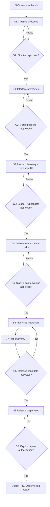

# Layout-First Engineering (LFE)

**A human-led, design-first product-to-production Agent Skill.**

[Leia em português](README.pt-BR.md)

LFE guides an AI assistant to start with **art direction and editable interface prototypes**, ask focused questions only when they matter, reconcile what a beautiful UI implies about the product, then plan architecture, costs, security and engineering before writing production code.

This is an **open-source workflow skill** based on the [Agent Skills specification](https://agentskills.io/specification). It is not an AI model, a background worker, an MCP connector, or a guarantee of certification or production readiness. It will use connected design/code/research tools when actually available and authorized.

## What makes it different?

- **Layout-first**: proposes distinct visual directions before picking a programming stack.
- **You steer**: meaningful approvals at defined gates; 1–3 contextual questions at a time, not a 40-question form.
- **Product + Engineering Management**: requirements, prioritization, risks, delivery planning, cost of ownership, acceptance and handoff.
- **Senior engineering practice**: architecture alternatives, ADRs, TDD/BDD where appropriate, CI/CD, security/privacy by design, accessibility, performance, observability, rollback.
- **Portable state**: decisions, design links and current gate persist in project files so users can resume with another compatible agent.
- **Tool-agnostic**: Figma, MagicPath, Framer, code editors, image tools, git and deployments are *optional integrations*, not dependencies.

## Lifecycle and approval gates



The automation cannot bypass a user decision; routine tasks within approved scope can proceed without extra approvals.

## Install (agent skills)

The skill lives in [`layout-first-engineering/`](layout-first-engineering/SKILL.md). Copy the **whole directory**, not only `SKILL.md`. All commands below are examples run from the cloned repository.

### Claude Code

```bash
mkdir -p /path/to/your-project/.claude/skills
cp -R layout-first-engineering /path/to/your-project/.claude/skills/
```

For personal installation, use `~/.claude/skills/` instead. In Claude Code invoke `/layout-first-engineering` when supported or ask to run the skill.

### Gemini CLI

```bash
mkdir -p /path/to/your-project/.gemini/skills
cp -R layout-first-engineering /path/to/your-project/.gemini/skills/
```

Alternatively use `.agents/skills/` or install a published repository via `gemini skills install <repo-url> --path layout-first-engineering`. Run `/skills list` or `/skills reload` to confirm discovery. Gemini **CLI** support does not imply identical support in the consumer Gemini app.

### OpenAI Codex

```bash
mkdir -p /path/to/your-project/.agents/skills
cp -R layout-first-engineering /path/to/your-project/.agents/skills/
```

Alternatively use `~/.agents/skills/` for a user-level skill. Invoke as `$layout-first-engineering` where supported.

### Claude.ai (web)

Upload `layout-first-engineering-skill.zip` using the custom Skills UI, on an eligible plan. The ZIP contains the top-level `layout-first-engineering/` folder and the required `SKILL.md`. Actual availability depends on account settings and execution capabilities.

### ChatGPT (web)

Native uploaded Skills are documented for eligible **Business, Enterprise, Healthcare and Edu** workspaces, subject to permissions. Do not assume that ChatGPT Plus has the same Skills upload interface. If Skills aren't available, use **Codex** where supported, or load `SKILL.md` and relevant reference files as a project instruction/knowledge-base fallback; that fallback is *not* a native installed skill.

### DeepSeek, Qwen, other AI systems

These model families do not guarantee native filesystem skill discovery in every chat product. Use a compatible agent client that supports Agent Skills or load the instructions into the agent's system/project prompt and provide referenced files. MCP support, file access and execution depend on the host, not the underlying model name.

## First prompt

> Start Layout-First Engineering for an application that [one-sentence idea]. The primary audience is [audience]. I want a [aesthetic] experience. Lead the process, ask only what you need at each step and **do not start production code before we approve the design, product scope, architecture and costs**.

For an existing project:

> Resume Layout-First Engineering using my `PROJECT_STATE.md`, the latest approved `DESIGN_HANDOFF.md` and the repository. Show me the next unanswered decision without restarting discovery.

## What it produces

| Stage | Typical artifacts |
|---|---|
| S0–S2 | Visual directions, mockups/prototype and design tokens, `DESIGN_HANDOFF.md` |
| S3 | `PRODUCT_BRIEF.md`, requirement IDs, user flows, updated handoff |
| S4 | ADRs, trust boundaries, `COST_MODEL.md`, `RISK_REGISTER.md` |
| S5–S6 | Backlog, `DELIVERY_PLAN.md`, traceability, implemented increments |
| S7–S9 | Test evidence, release checklist, approved deployment, ops/learning plan |

Templates live in `layout-first-engineering/assets/`. Create only what helps the actual project.

## A note about pricing and security

LFE forces the assistant to **verify vendor pricing and date** when live research is available. Without verification, numbers are marked illustrative or unknown. Security and accessibility references guide work but do not substitute for independent review or certification.

## Development and validation

No paid services or Python packages are required to **install** this skill. The bundled read-only state validator runs with Python 3:

```bash
python3 layout-first-engineering/scripts/verify_project.py layout-first-engineering/assets/PROJECT_STATE.md
python3 -m unittest discover -s tests -v
```

Tests check structure and decision-gate logic; they **do not test actual AI behavior**. Human/evaluation testing across each model and connector is still required; see [`examples/acceptance-scenarios.md`](examples/acceptance-scenarios.md).

## Maintainer and GitHub release

**Created and maintained by [Merlin Fachetti (@merlinfachetti)](https://github.com/merlinfachetti).** The MIT license credits the original creator. Community contributors retain appropriate attribution for their own work; no AI co-author trailers are added by the supplied publishing scripts.

To publish from macOS to `~/Projects_MerlinFachetti/layout-first-engineering`, read [the maintenance and publishing guide (PT-BR)](docs/MAINTAINING.pt-BR.md) and run `bash scripts/publish-macos.sh` from the extracted project. Only the authorized personal GitHub account is accepted. CI runs weekly plus on PRs and commits, and never pushes code.

## Contributing, safety and license

Contributions and portability reports welcome; see [`CONTRIBUTING.md`](CONTRIBUTING.md) and [`SECURITY.md`](SECURITY.md). MIT licensed; see [`LICENSE`](LICENSE). No vendor endorsement or trademark affiliation.
