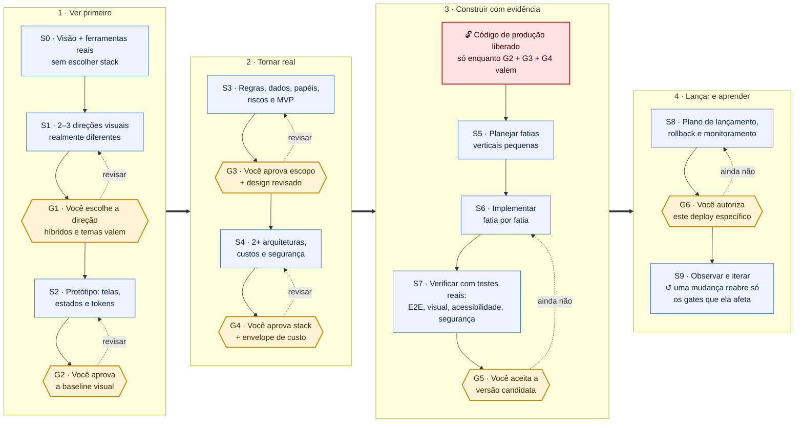

# Layout-First Engineering (LFE)

**Comunidade e governança:** [Comece pelo guia de colaboração, privacidade, segurança e atualização](docs/OPEN-SOURCE-MAINTENANCE.pt-BR.md). Consulte também [GOVERNANCE](GOVERNANCE.md), [CONTRIBUTING](CONTRIBUTING.md), [CODE_OF_CONDUCT](CODE_OF_CONDUCT.md), [SECURITY](SECURITY.md), [PRIVACY](PRIVACY.md), [SUPPORT](SUPPORT.md), [ROADMAP](ROADMAP.md).

**Atenção:** o repositório já foi publicado e a `main` está protegida. **Não repita a publicação inicial nem execute push direto na `main`**; faça alterações por branch e Pull Request. O procedimento atualizado é o guia acima.

**Uma skill open source para transformar uma ideia visual em um produto digital real, com o usuário no comando.**

[English README](README.md)

## A ideia

Primeiro a IA propõe **conceitos visuais realmente diferentes**, cria as primeiras interfaces e pede sua aprovação. Em seguida, como Product Manager, faz a descoberta aprofundada do produto, identifica lacunas e comportamentos ocultos, reconcilia com as telas e consolida requisitos. Só depois atua como arquiteta e Engineering Manager para comparar tecnologias, fornecedores, custos, segurança, prazo e manutenção. A implementação começa **somente com aprovações explícitas**.

**Não é um agente completamente autônomo**: é um processo guiado. A IA executa o trabalho de cada etapa, mas perguntas importantes surgem à medida que se tornam necessárias. Você pode responder apenas à pergunta atual, adicionar contexto opcional, adiar detalhes, solicitar alternativas, corrigir decisões ou pausar e continuar.

## Etapas e checkpoints

| Etapa | Trabalho da IA | Aprovação |
| --- | --- | --- |
| S0 | Entender o propósito inicial e verificar ferramentas reais | — |
| S1 | Oferecer direções visuais, com referências e trade-offs | **G1:** escolher direção |
| S2 | Criar protótipos, layouts responsivos, estados e tokens | **G2:** aprovar interfaces |
| S3 | Descobrir regras de negócio, dados, usuários, riscos e MVP | **G3:** aprovar escopo e design revisado |
| S4 | Comparar stacks, custos (inicial/mensal/crescimento), arquitetura, segurança | **G4:** aprovar investimento e arquitetura |
| S5 | Organizar backlog, dependências, critérios de aceite e entregas | Dentro do escopo aprovado |
| S6 | Construir por incrementos testáveis e comparar com o layout | Revisões por entrega |
| S7 | Verificar funcionalidade, visual, desempenho, acessibilidade e segurança | **G5:** aceitar versão candidata |
| S8 | Preparar lançamento, rollback, monitoramento e operação | **G6:** autorizar publicação |
| S9 | Acompanhar resultados e iterar | Conforme mudanças |

### Fluxo visual



**Como ler:** caixas azuis são trabalho da IA; hexágonos amarelos são decisões **suas** (gates); a caixa vermelha é o único ponto em que código de produção passa a ser permitido. Setas tracejadas são voltas de revisão: nada avança por silêncio.

A skill não inventa integrações ou preços: se não houver conector de Figma, por exemplo, ela documenta o design em formato possível e esclarece a limitação. Se não houver pesquisa web, não apresenta valores de fornecedores como preços atualizados.

## Instalação completa, uso e publicação

**Documentação para consulta permanente:**

- **[MANUAL MESTRE — Tudo sobre funcionamento, instalação, GitHub e manutenção](docs/MANUAL-MESTRE.pt-BR.md)** — a página principal, completa e preservada no repositório.

- **[Motor `lfe`: trava, lembra e prova — passo a passo](docs/LFE-CLI.pt-BR.md)** — aprovações só suas, retomada automática e recibos de teste.
- **[Instalar e usar em ChatGPT, Claude, Gemini CLI, Codex, DeepSeek, Qwen e outros](docs/INSTALACAO-E-USO.pt-BR.md)** — com comandos, diferenças entre plataformas, conectores, exemplos, retomada e troubleshooting.
- **[Publicar no GitHub (macOS) e corrigir erros de caminho](docs/PUBLICACAO-GITHUB-MAC.md)** — comando independente do diretório atual e diagnóstico.
- **[Dois prompts mestres originais: design e engenharia](docs/PROMPTS-MESTRES.pt-BR.md)** — para consulta e fallback em qualquer IA.
- [Manter o repositório e lançar novas versões](docs/MAINTAINING.pt-BR.md).

## Como instalar (resumo)

Baixe o ZIP da skill ou clone o repositório. Copie **a pasta inteira** `layout-first-engineering`, incluindo `SKILL.md`, `references/`, `assets/` e `scripts/`.

- **Claude Code — plugin (recomendado):** instala a skill, o motor `lfe`, o bloqueio por gates e a retomada automática de uma vez, com os comandos `/lfe:status`, `/lfe:next`, `/lfe:resume` e `/lfe:studio`. No terminal, rode um comando por vez e depois reinicie o Claude Code:

  ```bash
  claude plugin marketplace add merlinfachetti/layout-first-engineering
  ```

  ```bash
  claude plugin install lfe@layout-first-engineering
  ```

  Dentro de uma sessão, os equivalentes são `/plugin marketplace add merlinfachetti/layout-first-engineering` e `/plugin install lfe@layout-first-engineering`. Guia: [docs/LFE-CLI.pt-BR.md](docs/LFE-CLI.pt-BR.md).
- **Claude Code — só a pasta da skill:** coloque a pasta em `.claude/skills/` (no projeto) ou `~/.claude/skills/` (uso pessoal).
- **Gemini CLI:** coloque em `.gemini/skills/` ou `.agents/skills/`; use `/skills list` para conferir. No repositório publicado, `gemini skills install <URL> --path layout-first-engineering` também é uma opção, conforme a versão.
- **OpenAI Codex:** coloque em `.agents/skills/` (projeto) ou `~/.agents/skills/` (usuário).
- **Claude.ai:** envie o ZIP no recurso de Skills customizadas, caso esteja disponível para o plano e conta.
- **ChatGPT web:** Skills nativas dependem de elegibilidade e configurações de workspace. **Não presuma disponibilidade no Plus**. Codex ou instruções em um projeto são alternativas, com diferenças de funcionamento.
- **DeepSeek/Qwen/outros:** use um agente/cliente que aceite Agent Skills, ou importe as instruções como prompt de projeto. O modelo, isoladamente, não instala necessariamente a skill.

A referência oficial do formato é https://agentskills.io/specification. Consulte também o README em inglês para comandos e fontes técnicas.

## Prompt para iniciar

> Use a skill **layout-first-engineering**. Quero criar [ideia] para [público]. Minha inspiração visual é [estilo/referências]. Você deve conduzir desde a interface até a engenharia e os custos, uma etapa por vez. Pergunte somente o necessário para a decisão atual. Posso dar contexto adicional, mas não quero um formulário gigante. Antes de desenvolver software de produção, exija minha aprovação do design, escopo, arquitetura e orçamento. Registre as decisões para eu poder continuar em outra IA.

## Exemplo do que a skill deve perguntar

**IA:** "Proponho uma direção editorial com tipografia forte, ou uma direção imersiva com imagens cinematográficas. Recomendo editorial para priorizar a leitura. Qual você prefere? Pode misturar estilos ou dizer 'não sei'."

**Usuário:** "Quero editorial, mas com imagens cinematográficas."

**IA:** "Direção consolidada. Vou preparar as telas principais; nesta fase ainda não escolherei a linguagem de programação."

Mais tarde, depois de aprovado o layout:

**IA:** "O layout mostra uma biblioteca privada de arquivos. Isso muda a engenharia: cada usuário verá apenas seus próprios itens? Recomendo isolamento por conta."

A pergunta surge **porque a decisão afeta a segurança e o produto**, não porque uma checklist exige perguntar tudo no início.

## Entregáveis e transparência

Modelos de `PROJECT_STATE.md`, `DESIGN_HANDOFF.md`, `PRODUCT_BRIEF.md`, `DECISIONS.md`, `COST_MODEL.md`, `RISK_REGISTER.md`, `DELIVERY_PLAN.md` e `TRACEABILITY.md` estão em `layout-first-engineering/assets/`.

O arquivo de estado permite transportar decisões entre agentes. O validador de gates, incluído em `scripts/verify_project.py`, não executa ações externas, não cria software e não substitui uma auditoria real da IA.

Código e documentação licenciados sob MIT. Contribuições podem propor melhorias de acessibilidade, segurança, UX, custos, engenharia e suporte a novas plataformas.

## Autoria, publicação e manutenção

**Criado e mantido por [Merlin Fachetti (@merlinfachetti)](https://github.com/merlinfachetti).** O copyright MIT identifica o criador original, e contribuições humanas posteriores mantêm sua devida atribuição. Os scripts de publicação não adicionam coautoria de IA.

**Se o repositório já existir, NÃO repita a publicação inicial:** veja [atualização do GitHub](docs/MANUAL-MESTRE.pt-BR.md#7-como-atualizar-um-repositório-já-publicado). Para publicar o projeto no GitHub como repositório público e salvar a cópia local no Mac em `/Users/alden.fachetti/Projects_MerlinFachetti/layout-first-engineering`, siga [o guia de manutenção](docs/MAINTAINING.pt-BR.md). Execute `bash "$HOME/Downloads/lfe-publish/PUBLICAR_NO_GITHUB.command"` após extrair o ZIP em `~/Downloads/lfe-publish` (ou `bash scripts/publish-macos.sh` de dentro da raiz extraída): ele verifica sua conta e pede autorização antes de enviar. O CI roda nos commits, PRs e semanalmente sem criar commits.


## Evolução e validação

- [Laboratório de evolução — índice público de melhorias](docs/LFE-EVOLUTION-LAB.md)
- [Matriz de validação — o que de fato rodou, com datas](docs/VALIDATION-MATRIX.md)
- [RFCs: contratos do core e a primeira fatia vertical](docs/rfcs/README.md)

Os testes offline e a prova do VS-01 no navegador são evidência do motor e do exemplo, não certificação do comportamento do agente em todos os clientes; as execuções com agentes reais ficam na matriz de validação.
